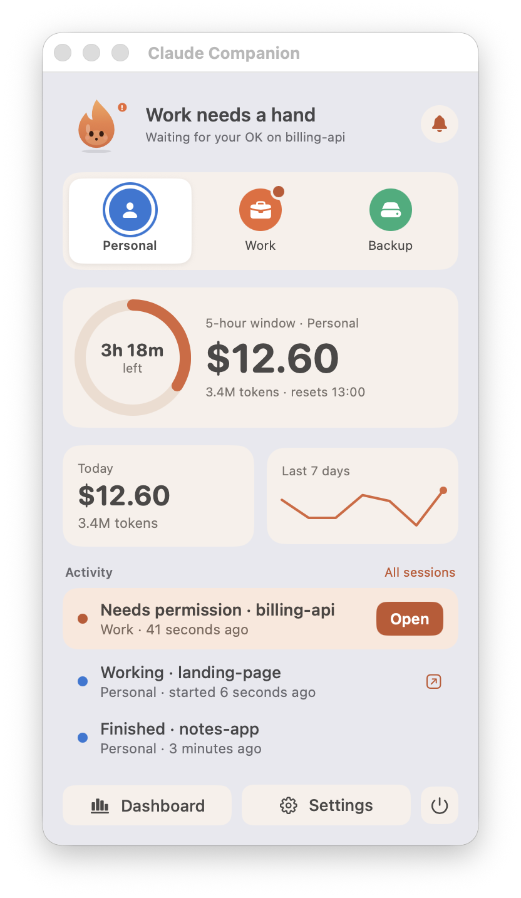
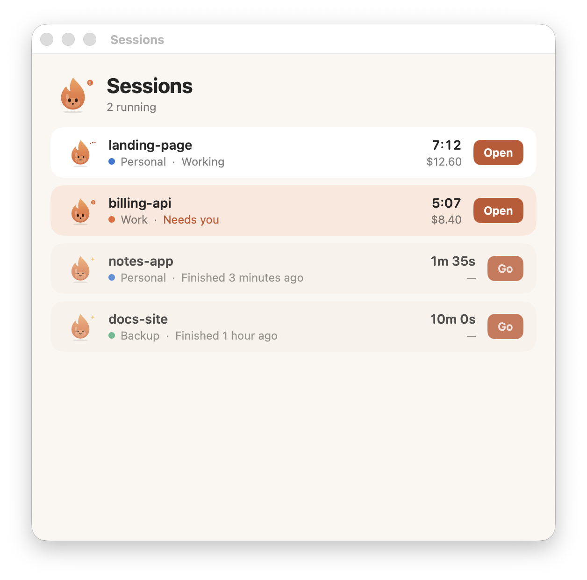
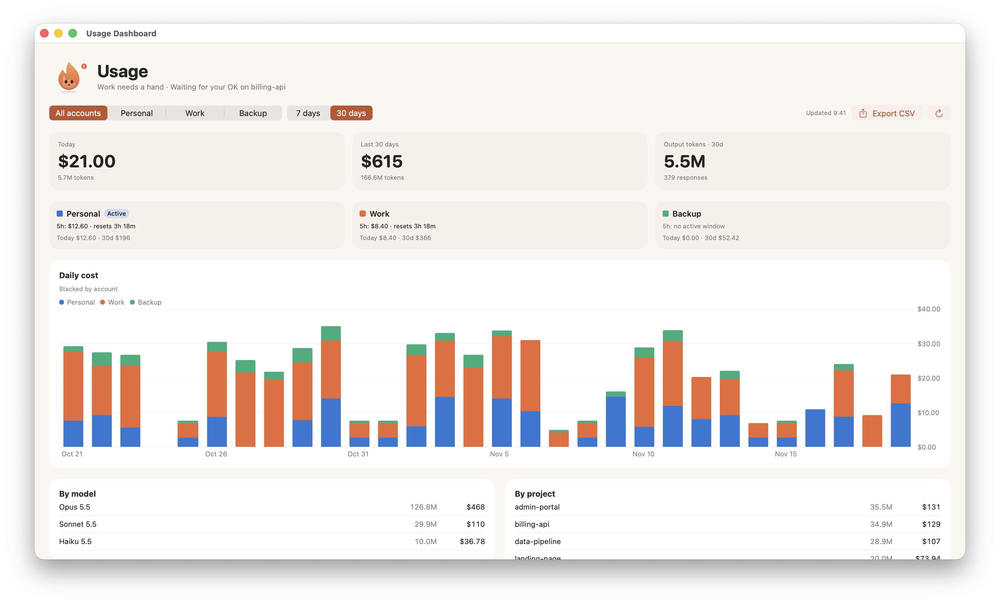

<p align="center">
  
</p>

<h1 align="center">Claude Companion</h1>

<p align="center">
  <b>A little menu bar companion for Claude Code on macOS.</b><br>
  Switch accounts, know the moment Claude needs you, and see what you use.<br>
  Flick keeps an eye on things while you look away.
</p>

<p align="center">
  <a href="https://github.com/remi-dc/claude-companion/releases/latest"></a>
  
  
  
  <a href="LICENSE"></a>
</p>

<p align="center">
  <picture>
    <source media="(prefers-color-scheme: dark)" srcset="docs/images/dark/popover.png">
    
  </picture>
  &nbsp;
  <picture>
    <source media="(prefers-color-scheme: dark)" srcset="docs/images/dark/sessions.png">
    
  </picture>
</p>

<p align="center">
  <code>curl -fsSL https://raw.githubusercontent.com/remi-dc/claude-companion/main/install.sh | sh</code>
</p>

---

## Meet Flick

Flick is a small ember who lives in your menu bar and shows what Claude is doing across all your sessions.

<p align="center">
  
</p>

He flickers while Claude works, hops when a session needs your OK, cheers when it's done and naps when things are quiet. Pick his color (Ember, Glacier, Mint or your account's color) and size, turn his friendly messages off, or keep him still in calm mode.

## What it does

<table>
<tr>
<td width="50%" valign="top">

### 👥 Accounts
- **Switch** between Personal, Work and Backup (or your own) from the menu bar or a shortcut.
- Works for the `claude` command **and** the VS Code, Cursor and Windsurf extensions.
- **Sign in with** the right browser or Chrome profile for each account.

</td>
<td width="50%" valign="top">

### 🔔 Notifications
- When Claude **finishes**, **needs permission** or is **waiting** for you.
- **Click to jump** to the exact Terminal tab or VS Code conversation.
- Each event either **disappears** or **stays on screen** until it's handled.
- A **different sound** per account and event.

</td>
</tr>
<tr>
<td width="50%" valign="top">

### 📊 Usage
- The **5-hour window**, today, 7 and 30 days, by account, model and project.
- A **Sessions** window with live timers and cost per session.
- **Alerts** you switch on one by one: monthly budget, busy window, window reset, daily summary.
- **Export** to CSV.

</td>
<td width="50%" valign="top">

### ✨ Comfort
- **Global shortcuts** you record yourself (⌥⌘1/2/3, ⌥⌘C, ⌥⌘S by default).
- **Built-in updates**: one click, verified, relaunches itself.
- Light on your Mac: **~0% CPU** when idle; hooks return in milliseconds.

</td>
</tr>
</table>

<p align="center">
  <picture>
    <source media="(prefers-color-scheme: dark)" srcset="docs/images/dark/dashboard.png">
    
  </picture>
</p>

<sub>Screenshots use the app's built-in demo data, not real accounts.</sub>

## Install

Paste this in Terminal:

```sh
curl -fsSL https://raw.githubusercontent.com/remi-dc/claude-companion/main/install.sh | sh
```

Then click the chat-bubble icon in the menu bar and **Install** in the orange banner. That's it.

You need **macOS 14 (Sonoma) or later** and [Claude Code](https://docs.anthropic.com/en/docs/claude-code). The installer downloads the latest release (a universal app), puts it in `/Applications` and launches it. You can [read the script](install.sh) first.

> **Why a Terminal command and not a download link?** The app isn't notarized by Apple (that needs a paid developer account), so macOS blocks it when it's downloaded in a browser. Downloads made with `curl` don't get that block.

<details>
<summary><b>Build from source</b></summary>

Needs the Xcode Command Line Tools (`xcode-select --install`):

```sh
git clone https://github.com/remi-dc/claude-companion.git
cd claude-companion
./scripts/build.sh --install   # builds, copies to /Applications, launches
```

`./scripts/build.sh` on its own builds `build/Claude Companion.app` without installing it; `--universal --zip` makes a release zip. The app icon is generated from code. The app has no Dock icon; look for it in the menu bar.

</details>

## Setup

Open the menu bar icon → **Settings** → **Setup**:

1. **Allow notifications** when macOS asks (or use **Open Notification Settings**).
2. **Install hooks**: lets Claude Code tell the app what's happening. Your existing settings and hooks are kept, and a backup is saved.
3. **Install shell integration**: the `claude` command follows the account picked in the menu bar.
4. **VS Code** (optional): the Claude Code extension follows it too (also Cursor, Windsurf, Insiders).
5. **Log in to each account**: Settings › Accounts › **Log in…**, then `/login`. Pick a browser profile under **Sign in with** first if you use several.

| Account | Config directory | "Finished" sound |
| --- | --- | --- |
| Personal | `~/.claude` (Claude Code's default) | Glass |
| Work | `~/.claude-work` | Hero |
| Backup | `~/.claude-backup` | Purr |

Rename accounts, change their folders or add more in Settings › Accounts (then **Install hooks** again).

<details>
<summary><b>How it works</b></summary>

**Account switching.** Each account is a separate Claude Code config directory (`CLAUDE_CONFIG_DIR`), with its own login, settings and history. The menu bar writes the active one to `~/.claude-companion/active-config-dir`; the `claude` wrapper reads it, exports `CLAUDE_CONFIG_DIR` and runs the real `claude` (Personal leaves it unset). The wrapper steps aside if you set `CLAUDE_CONFIG_DIR` yourself or `CLAUDE_COMPANION_BYPASS=1`. In VS Code, the extension runs `claude-vscode-wrapper <bundled claude> <args>`, which applies the same rule. For sign-in, the wrappers set `$BROWSER` to the account's browser profile.

**Notifications.** `Stop`, `Notification`, `UserPromptSubmit` and `PostToolUse` hooks run `~/.claude-companion/bin/claude-companion-hook`, a tiny shim that hands the event to the app in the background, so Claude never waits. The app works out each session's state (Flick's mood), plays the account's sound and shows the notification. It also records where the session runs (app, folder, terminal) so a click can take you back there.

**Usage.** The app reads Claude Code's local transcripts (`<config dir>/projects/**/*.jsonl`, last 35 days), only the new lines on each pass, removes duplicates and prices tokens at Anthropic API list prices, cache included.

**Updates.** Every few hours the app asks GitHub's public API for the latest release (one anonymous request). Updating downloads the zip, checks the bundle id, version and signature, swaps the app and relaunches; if anything fails, the old version is put back.

</details>

<details>
<summary><b>Command line</b></summary>

```sh
APP="/Applications/Claude Companion.app/Contents/MacOS/ClaudeCompanion"
"$APP" usage                   # per-account usage summary in the terminal
"$APP" check-update            # compare with the latest GitHub release
"$APP" open dashboard          # or: open settings, open sessions, open popover
"$APP" demo-shots <dir> [dark] # run on demo data and list its windows (README screenshots)
"$APP" render-icon <dir>       # write the app icon PNGs (used by build.sh)
```

</details>

<details>
<summary><b>Troubleshooting</b></summary>

- **No notifications from real sessions, but the test buttons work:** the hooks aren't installed (the popover shows an orange **Install** banner). Sessions opened before installing need a restart.
- **Notifications land in Notification Center but don't pop up:** your display is probably mirrored or shared. Turn on "Allow notifications when mirroring or sharing the display" in System Settings › Notifications.
- **"Stays on screen" cards show during Focus:** they're drawn by the app, so Focus modes don't hide them. Set that event to *Disappears* if you prefer macOS to handle it.
- **See what a hook sends:** `echo '{"cwd":"/tmp/x"}' | CLAUDE_COMPANION_DEBUG=1 "$APP" hook stop --account personal`

</details>

<details>
<summary><b>Limitations</b></summary>

- The **Claude desktop app** always uses the Personal account (`~/.claude`). Notifications still work for it.
- **Running sessions keep their account**; switching affects new sessions.
- **Costs are estimates** at API list prices. Pro and Max plans aren't billed per token, and your plan's real usage-limit percentage isn't stored locally.
- Model prices live in `Sources/ClaudeCompanion/Usage.swift`.

</details>

<details>
<summary><b>Uninstall</b></summary>

1. Settings → Setup → **Remove hooks**, and **Remove** next to each configured editor.
2. Delete the `# Claude Companion` line from `~/.zshrc`.
3. Quit the app, then delete `/Applications/Claude Companion.app` and `~/.claude-companion`.

Your Claude Code folders, logins and history stay as they are. The `*.companion-backup` files can be deleted once you're happy.

</details>

<details>
<summary><b>For maintainers</b></summary>

Publish a release (bumps the version, builds the universal app, commits, pushes, creates the GitHub release; every running copy then offers the update):

```sh
./scripts/release.sh 1.5.0 "What's new, in one line"
```

Refresh the README screenshots from demo data:

```sh
./scripts/build.sh && "build/Claude Companion.app/Contents/MacOS/ClaudeCompanion" demo-shots /tmp/shots
```

</details>

---

<p align="center">
  <sub>Unofficial community project, not affiliated with or endorsed by Anthropic. MIT licensed, see <a href="LICENSE">LICENSE</a>.</sub>
</p>
